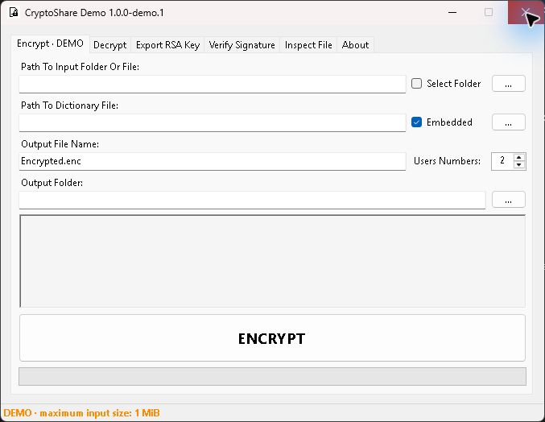
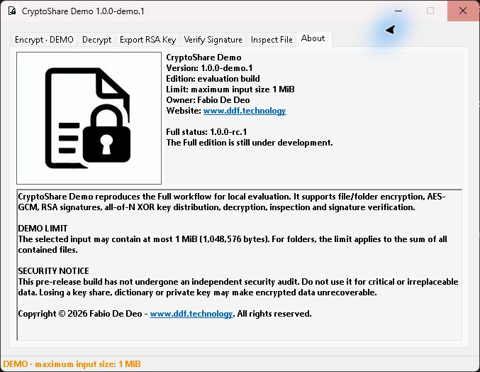

# CryptoShare Demo

Public release channel for **CryptoShare Demo 1.0.0-demo.1**, a Windows x64 evaluation build of
CryptoShare Full **1.0.0-rc.1**.

CryptoShare encrypts files or folders with AES-GCM, signs data with RSA and divides the AES key into
an all-of-N set of shares. It also provides decryption, RSA public-key export, signature verification
and encrypted-package inspection.

## Demo limitation

The Demo reproduces the Full interface and workflow. Its only intentional limitation is the input
size: one selected file, or the sum of all files in one selected folder, may contain at most
**1 MiB (1,048,576 bytes)**.

## Download

Use the [GitHub Releases](https://github.com/DDF-Technology/CryptoShare-Preview/releases) page.
The Windows package is unsigned; verify the SHA-256 value shown in the release before running it.

## Important security notice

Full and Demo are pre-release software and have not undergone an independent security audit. Do not
use them for production, critical or irreplaceable data. Losing any required key share, external
dictionary or private key can make encrypted data permanently unrecoverable.

## Ownership

CryptoShare is proprietary software. Copyright © 2026 Fabio De Deo —
[www.ddf.technology](https://www.ddf.technology/). The Demo is supplied solely for evaluation under
[LICENSE](LICENSE). No source code is published in this repository.

Third-party components and their owners are identified in [THIRD_PARTY_NOTICES.md](THIRD_PARTY_NOTICES.md).

## Screenshots

